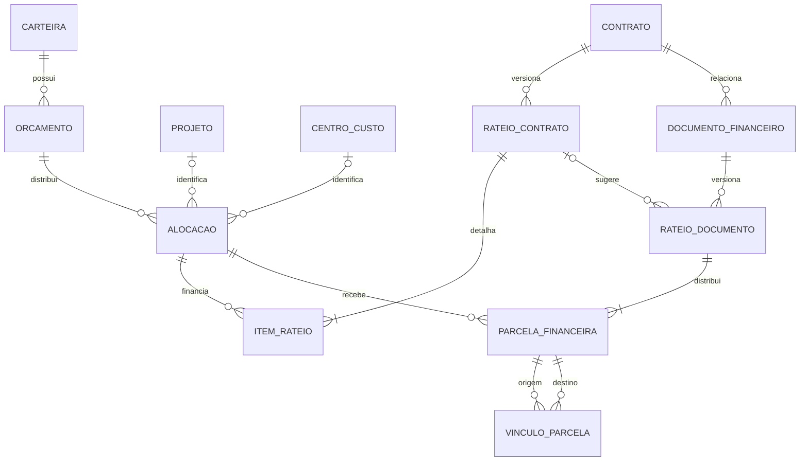

# EngFinance — arquitetura e decisões

## Marco atual: estrutura funcional inicial

Django/DRF fornece API, serviços e ORM; React apresenta os cadastros; PostgreSQL é o banco operacional. O app `registry` agrupa cadastros sem regras financeiras nesta primeira entrega. A futura divisão em portfolios, projects e contracts deve preservar migrations e referências.

Autorização combina permissões Django (usuários/grupos) e DepartmentAccess. Listagem, detalhes e escrita são limitados ao escopo. Fornecedores são cadastro compartilhado, com permissão de modelo. Superusuário é uma conta técnica excepcional. Não existem aprovações financeiras nesta etapa. Acesso por carteira/projeto e visibilidade parcial de contratos compartilhados serão acrescentados antes do núcleo financeiro.

O login local funciona somente com DEBUG=true. Entra ID, MFA, proteção contra força bruta e endurecimento de produção ainda dependem da configuração corporativa. Este marco não está pronto para produção.

## Regra confirmada: contrato com múltiplas carteiras

Contrato não possui FK para carteira. Projeto também não impõe fonte única de financiamento enquanto a política está pendente.

Esse diagrama é planejamento da fase financeira; as tabelas de rateio ainda não foram implementadas. Documento financeiro especializa compromisso, medição, nota fiscal ou pagamento. Valores por etapa serão agregados pelas parcelas, sem somar cabeçalho, distribuição planejada e execução. Vínculos conciliam valores e não geram consumo adicional. Versões aprovadas ficam preservadas. Rateio específico de documento exige validação e aprovação; mudança contratual não reescreve documentos anteriores.

## Decisões pendentes antes da fase financeira

- Base distribuída e efeito de reserva do rateio contratual.
- Definições de alocado, comprometido e realizado.
- Alçadas, segregação de funções e autorização formal de insuficiência orçamentária.
- Projeto/centro de custo obrigatórios ou opcionais; CAPEX/OPEX misto.
- Exercício, transferência de saldo, encerramento e reabertura.
- Retenções, adiantamentos, impostos e reversões.
- Rateios distintos entre etapas e reclassificação das fontes.
- Visibilidade de contratos compartilhados entre gerências.

Antes das avaliações: elegibilidade, confidencialidade, critérios e pesos. Antes dos relatórios: fórmulas e datas de referência. Antes da IA: provedor autorizado e dados permitidos.

## Próximos marcos

1. Completar fase 2: homologar cadastros, perfis e acesso; preparar identidade corporativa conforme disponibilidade.
2. Fase 3A: orçamento, fontes e rateios versionados, após decisões aprovadas.
3. Fase 3B: execução financeira, reversões, idempotência, conciliação e testes reais de concorrência PostgreSQL.
4. Avaliações, relatórios e IA nas fases seguintes.

Não há cálculos financeiros provisórios no sistema. Dependências futuras de dados (Pandas/Openpyxl) e IA serão adicionadas quando os respectivos módulos forem construídos.
