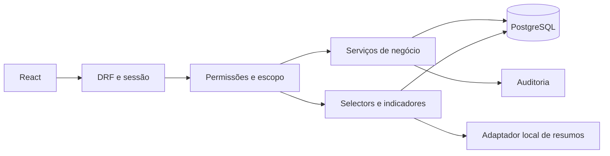
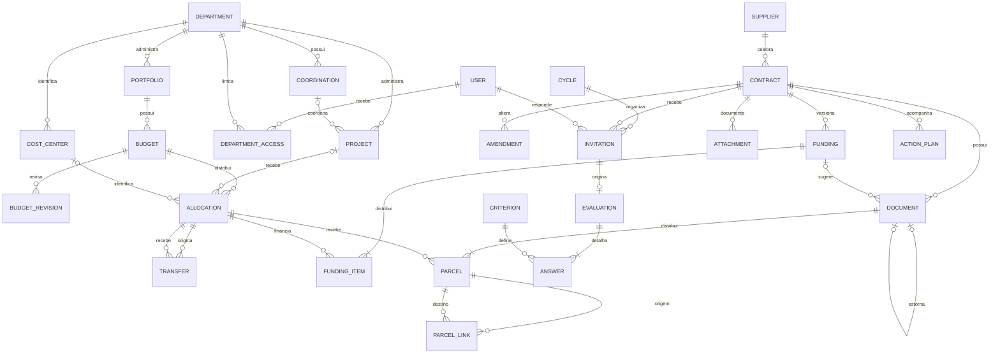

# EngFinance — arquitetura implementada

Versão local funcional para demonstração. O planejamento inicial está preservado em architecture-initial.md. A autorização mais recente permitiu avançar nos módulos; as regras corporativas pendentes continuam explícitas e bloqueiam uso real sem configuração/validação.

## Componentes

React/TypeScript/Vite/Tailwind apresenta a aplicação e Recharts desenha os indicadores. Django/DRF recebe requisições e controla sessão/CSRF/permissões. Serviços executam comandos financeiros e transações. Selectors calculam indicadores em Decimal; PostgreSQL persiste e garante restrições. O adaptador de IA local só gera texto a partir de dados autorizados.

É um monólito modular. Registry mantém os cadastros; finance concentra orçamento/rateio/execução; evaluations guarda ciclos e respostas; accounts controla identidade; ai isola os provedores. A apresentação React substitui os templates nas telas operacionais; o Django Admin permanece para administração técnica.

## Entidades principais

Document é o documento financeiro tipado: compromisso, medição, nota fiscal ou pagamento. Suas parcelas são a fonte dos valores consolidados. A tabela M2M de origens admite vários documentos anteriores; ParcelLink registra a conciliação dos valores entre parcelas. Nenhum desses vínculos é somado novamente à execução.

Funding equivale ao RateioContrato e FundingItem às suas fontes. Cada versão preserva seu autor, motivo e aprovação. Não há FK exclusiva contrato/carteira. A relação projeto/contrato para financiamento é derivada das parcelas e fontes, evitando associação financeira redundante.

Budget e Allocation identificam exercício e CAPEX/OPEX sem replicar a carteira em todas as entidades. PeriodChange guarda versões aprovadas de fechamento/reabertura. Policy guarda o estado de demonstração e limites de alerta.

## Autorização

Grupos/permissões Django limitam ações; DepartmentAccess limita recursos. Documentos e rateios compartilhados só são visíveis integralmente a quem acessa a gerência do contrato e todas as gerências financiadoras. A opção conservadora evita vazamento por valores ou distribuição parcial. Uma futura visão parcial exige contrato explícito de apresentação e autorização.

Exportações, importações, relatórios e resumos usam os mesmos escopos. Dados individuais de avaliações exigem permissão específica, além do escopo. Códigos de recursos financeiros não permitem contornar a autorização por referência indireta.

## Integridade e concorrência

Chaves únicas, CHECKs, FKs PROTECT e migrations complementam as validações dos serviços. Transações atômicas usam bloqueio da política para serializar comandos financeiros e snapshots. É adequado ao piloto; alta concorrência exigirá bloqueios por fonte, testes de carga e revisão dos índices/consultas.

Aprovações e estornos são comandos próprios; o CRUD não altera/exclui operações aprovadas. Idempotência compara chave e fingerprint. O histórico é registrado junto da transação de negócio; anexos são privados e servidos como download autorizado.

## Infraestrutura e limites

Há ambiente local PostgreSQL e Compose de desenvolvimento, com volumes para banco e anexos. Dependências têm lockfiles. CI está definido localmente para PostgreSQL e build frontend. Nada foi enviado ao GitHub ou a sistemas corporativos.

Entra ID/MFA, IA externa, SAP, Power BI, SharePoint e homologação corporativa não estão configurados. As regras demonstrativas, seus cálculos e as definições pendentes estão em business-rules.md. O demonstrador não deve ser tratado como produção homologada.
